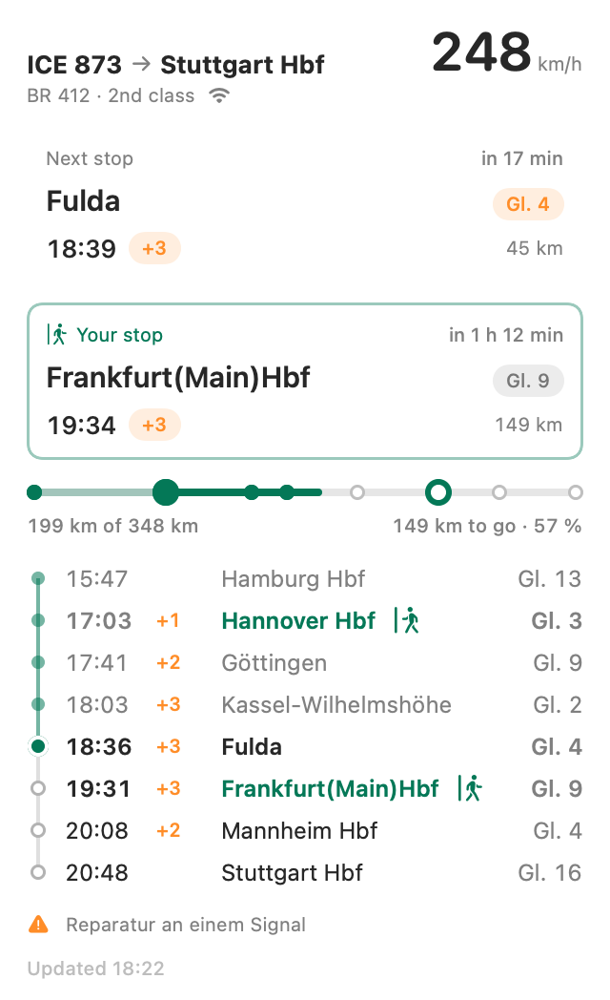

# Bordbar

Train speed in the macOS menu bar, trip details on click, from the ICE onboard portal (only reachable on WIFIonICE). API notes: `API.md`.

Unofficial. Not affiliated with or endorsed by Deutsche Bahn; it reads an undocumented API that can change without notice.

<picture>
  <source media="(prefers-color-scheme: dark)" srcset="docs/screenshot-dark.png">
  
</picture>

Screenshot with made-up trip data.

- **Menu bar app:** `macos/build-app.sh`, then `open macos/dist/Bordbar.app`. Test paths: `Bordbar --once` prints the menu contents, `Bordbar --render <dir>` writes the panel as light and dark PNGs, `--fixtures fixtures` uses saved responses instead of the train.
- **Your stops:** click a stop behind you to mark where you got on, one ahead for where you get off; click a marked stop again to clear it. The km, km-to-go and percent figures cover only that part; the bar still shows the whole route. Saved per train (date + train number). Test path: `Bordbar --once --click <evaNr>`.

## Gotchas

- Every rebuild gets a new ad-hoc signature, so Little Snitch asks again; until it is answered the app reads as "Not on ICE WiFi".
- Swift 6.4's default build system fails on Command Line Tools without Xcode ("Unknown error parsing property list"), so the build script uses `--build-system native`.
- SwiftUI's `MenuBarExtra` dropped the menu bar symbol and menu item images on macOS 27; the app uses an AppKit status item with a SwiftUI panel hosted in a menu item.
- SwiftUI's `@State` (and other SwiftUI macros) need Xcode's compiler plugin and fail to build with Command Line Tools; keep view state in the `@Observable` store.
- `ImageRenderer` hangs without a running `NSApplication`; the render path starts one invisibly.

## License

MIT, see `LICENSE`.
